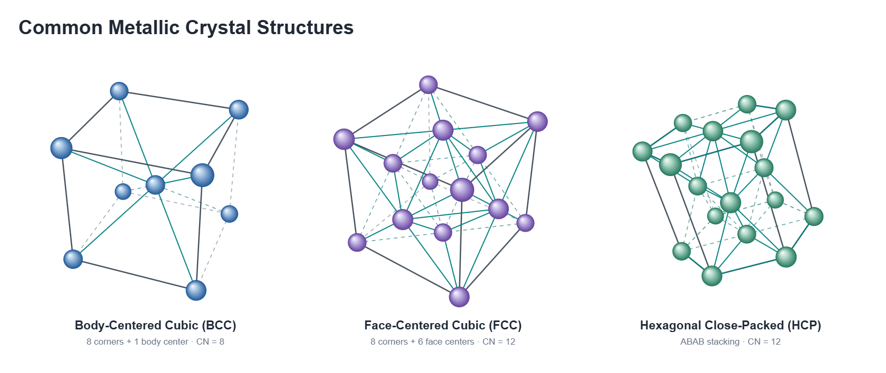
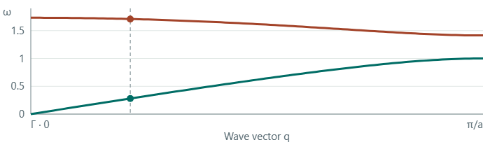
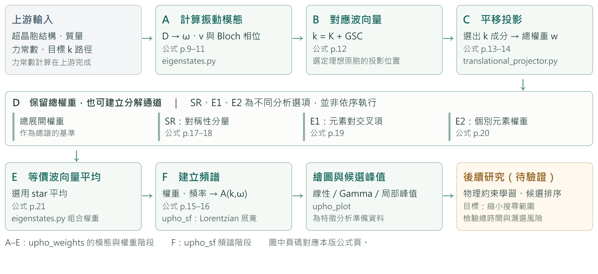

# 從聲子展開到物理約束學習：講稿

演講者：鄭兆崴　｜　指導老師：嚴健彰老師、林哲民老師

以 v002 的 24 頁簡報及其講者備註整理為口語草稿，並用既有 Markdown 補回公式與圖表來源。這不是錄音逐字稿；銜接句為整理時補寫。請直接修改下方「講述內容」，可自由合併、刪除或新增章節，不必維持原投影片頁數。

工作流程：先修改並確認本講稿，再擷取成 `learning.md`，最後產生下一版簡報。目前 `learning.md` 已同步更新至 v007。原有簡報頁碼僅供對照；物理約束學習的模型與驗證成果尚待補充。

## 01 從聲子展開到物理約束學習

<!-- source: versions/v002/phonon_to_physics_learning_v002.pptx; slide: 1 -->

### 講述內容

各位好，我是鄭兆崴，指導老師是嚴健彰老師、林哲民老師。幾個月前，我開始在每個禮拜五旁聽物理系陶瓷實驗室的 meeting。聽了幾次之後，我注意到一個很實際的問題：每測試一個配方，都要投入不少時間。從球磨與混合、煅燒、高溫燒結，到後續研磨、被銀與極化，還有量測與退火，都需要安排時間。當候選配方很多時，逐一製作與測試的成本就會累積。

所以我想解決的問題是：能不能在燒出第一片陶瓷前，先縮小材料搜尋範圍，把時間留給更值得驗證的配方？我希望最後得到的是一份有依據的候選排序，幫助我們決定哪些先做、哪些還需要補資料。

今天的內容會圍繞這個目標。先說明如何描述候選材料，再介紹如何把振動資訊整理成可比較的特徵，最後討論這些特徵如何接到未來的物理約束學習。目前展示的是 Cu–Au 算例的資料整理方法；能縮小多少搜尋範圍、能節省多少時間，還需要用目標陶瓷材料與實驗結果驗證。

首頁 QR code：https://jerry-ya-ya.github.io/upho/#home

### 對照材料（原投影片重點、圖表與公式）

演講者：鄭兆崴

指導老師：嚴健彰老師、林哲民老師

能不能在燒出第一片陶瓷前
先決定哪幾個配方值得做？

### 來源與補充

以這個問題作為演講開場。本次內容先介紹晶體結構與聲子，再展示 repo 內兩個合金例子的圖譜。Cu–Au 是方法示範，不是陶瓷配方的預測結果。物理約束學習的模型與實驗驗證留待後續加入。

## 02 常見晶體結構

<!-- source: versions/v002/phonon_to_physics_learning_v002.pptx; slide: 2 -->

### 講述內容

要縮小搜尋範圍，第一個問題是：我們到底在搜尋什麼？除了元素與比例，原子如何排列也需要被描述。因此先看 BCC、FCC 與 HCP，目的是建立候選結構的共同描述方式。

圖中的灰線是晶胞邊界，青綠線是最近鄰連接。以 BCC 為例，體心原子連接八個角點。這些排列與鄰接資訊，是我們之後比較結構的起點。實際研究陶瓷時，還要換成目標材料適用的結構，才能界定有意義的搜尋範圍。

### 對照材料（原投影片重點、圖表與公式）

灰線表示晶胞邊界，青綠線表示圖中原子的最近鄰連接。

### 來源與補充

來源：../reference/src/pages/crystals/crystals.html。圖中 BCC 的體心連接八個角點。畫面只顯示有限晶胞，完整配位數需包含相鄰晶胞的原子。

## 03 晶體結構比較

<!-- source: versions/v002/phonon_to_physics_learning_v002.pptx; slide: 3 -->

### 講述內容

搭配這張表，我們可以把結構描述得更一致：BCC 的最近鄰配位數是八，FCC 與理想 HCP 是十二，HCP 的密排層以 ABAB 堆疊。完整配位數也要包含相鄰晶胞。

對材料搜尋來說，這些資訊可以先用來整理候選、區分不同結構條件，讓後面的比較有共同基準。不過，配位數本身還不足以決定哪個配方值得做。我們接下來需要更多能反映原子相互作用的資訊。

### 對照材料（原投影片重點、圖表與公式）

| 結構 | 原子排列 | 最近鄰配位數 |
| --- | --- | --- |
| BCC 體心立方 | 立方體角點與體心 | 8 |
| FCC 面心立方 | 立方體角點與面心 | 12 |
| HCP 六方最密堆積 | 密排層以 ABAB 方式堆疊 | 12 |

配位數描述一個原子在完整晶體中的最近鄰數量。

### 來源與補充

來源：../reference/src/pages/crystals/crystals.html。HCP 圖採理想 c/a = √(8/3)。這些是基礎結構示意，不能直接代表所有陶瓷的晶體結構。

## 從晶胞到超晶胞：描述可計算的候選材料

### 講述內容

晶胞與超晶胞是建立候選材料模型的起點。原胞最小但不一定只有一顆原子。超晶胞仍然週期重複，可以近似描述無序或缺陷，並用於有限位移力常數計算。增加尺寸會增加計算成本，需要驗證收斂。把模型變大後，布里淵區會縮小，原胞的不同波向量會折疊在一起。展開提供比較基準，但不會自動省下前段計算時間；我們仍要檢驗整體篩選流程的效益。
來源：reference 晶體結構頁的晶胞與倒空間導讀。

## 波向量：比較晶胞之間的振動相位

### 講述內容

倒空間以波描述實空間的週期變化。若平移晶格後，波的相位改變整數倍的 2π，便得到倒格向量 G 的定義。選 q 不是讓原子移動到某個地點，而是選擇不同晶胞如何配合振動。本頁的 a 是兩顆原子構成的晶胞重複長度，不是 A 與 B 的最近鄰距離。保持這些定義一致，才能避免把座標差異當成材料差異。

## Γ 點與布里淵區：色散圖的路徑

### 講述內容

淺色區是一維第一布里淵區，範圍是負 π/a 到正 π/a。Γ 是中心，區界是端點，兩端在晶格平移相位上等價。網站拉桿走綠色的 Γ 到正區界路徑；圖中橘色點是 qa/π = 0.22。Γ 的聲學模態是零頻率整體平移，光學模態仍可反向振動。三維常見的 X、L、M、K 是特定晶格與座標慣例下的高對稱點，不能把每一個區界都稱作 X。色散圖把選定路徑逐段接在橫軸，不是原子的行走路線，也未涵蓋整個布里淵區。
來源：https://arxiv.org/abs/1602.06402 與 reference 聲子模態頁。

## 05 聲子色散：頻率與波向量

<!-- source: versions/v002/phonon_to_physics_learning_v002.pptx; slide: 5 -->

### 講述內容

如果每個候選都只用一段原子動畫描述，很難快速比較。因此，我們把不同波向量對應的振動頻率整理成聲子色散。這個模型的聲學支在 Γ 點到達零頻率，光學支則維持有限頻率。

這張圖提供一種可能的比較表示：之後可以研究頻率位置、分支形狀等資訊，哪些有助於區分候選材料。要讓它真正縮小搜尋範圍，仍然需要建立這些資訊與目標性能之間的關係。

三維週期晶體的原胞若有 n 個原子，每個原子有三個位移自由度，因此在每個波向量上有 3n 個模態，沿波向量連起來形成 3n 條分支。其中三條是聲學支，其餘 3n−3 條是光學支。聲學支在長波長極限頻率趨近零。這裡的一維雙原子鏈只保留縱向自由度，所以兩個原子提供兩條分支：一條聲學、一條光學。下一頁再看兩種模式的原子位移，區分色散關係與位移快照。

### 對照材料（原投影片重點、圖表與公式）

Γ 點的聲學支頻率為零；光學支維持有限頻率。

頻率單位為 √(K/m)，K 是彈簧常數。曲線為本頁雙原子鏈模型。

### 來源與補充

來源：../reference/src/pages/modes/modes.html。在此模型，聲學支在 Γ 附近近似線性，光學支在 Γ 附近較平坦。此圖是頻率對波向量，與下一頁的位移對空間相位不同。

## 先看整體：位移曲線與原子運動同步

### 講述內容

先完整看一次組合動畫。上方每欄是下方一組 A／B 的位移曲線，底端標記顯示當下位移。下方是橫向原子鏈，兩者使用相同的波向量、振幅、空間相位與時間。聲學和光學使用同一個時間尺度，因此光學振動較快。這段固定長度片段循環時回到初始時間，不表示兩個模態具有共同週期。先建立對應，再拆開講解，可以避免把曲線形狀誤認成原子的運動軌跡。
動畫由目前網站渲染器擷取，120 幀，每幀 80 毫秒，模型時間步長 0.2。這是一維示意，不是 Cu–Au 計算結果。

## 拆解一：原子如何振動？

### 講述內容

現在只看下半部的原子鏈。A 與 B 各自透過晶格平移重複，形成兩個子晶格。聲學與光學都有實際原子位移。相同波向量下，胞內振幅關係與頻率取決於所選分支；同相與反相是長波長附近的描述，不能直接套到整個布里淵區。在區界，本模型兩個分支各自只有其中一種原子振動。保留共用時間尺度，讓這一頁能直接對回前一頁。

## 拆解二：如何讀每組 A／B 的位移曲線？

### 講述內容

這一頁只留下上半部曲線。每欄是固定晶胞內 A／B 的時間位移表示，已經不是舊版的固定時間空間相位快照。橫軸是歸一化位移，向上顯示未來時間偏移，底端是現在。曲線振幅放大以便辨識；原子仍沿下方鏈的方向振動。質量比二比一時，Γ 光學振幅比是負二分之一，但目前 q 非零，程式依本徵模態求得振幅，沒有把這個比例固定套用到所有 q。對材料搜尋而言，先區分位移、時間、頻率與波向量，才有辦法定義一致且可驗證的特徵。

## 公式前導：UPHO 流程與公式位置

### 講述內容

在看公式之前，先用這張流程圖說明每一組公式要解決什麼問題。上游提供結構、質量與力常數，UPHO 先求出振動頻率與模態，再將超晶胞的資訊投影到理想原胞的波向量上，得到展開權重。

總權重可以直接建立總譜，也可以分析 SR 對稱性分量、E1 元素對與 E2 個別元素分量。這三種是不同分析選項。啟用 star 平均時，再組合等價波向量的結果；之後用 upho_sf 將權重與頻率組成頻譜，最後由 upho_plot 繪圖並提取候選峰值。

這裡先完成可比較的資料表示。把特徵接到物理約束學習、候選排序，並驗證能否節省總時間，是後續研究。接下來每組公式都可以回到這張圖，確認它處理的輸入、輸出與角色。

### 對照材料

圖中頁碼對應 v005 簡報；之後調整頁序時需同步更新。

## 07 超晶胞動力矩陣與聲子本徵模態

<!-- source: versions/v002/phonon_to_physics_learning_v002.pptx; slide: 7 -->

### 講述內容

現在要問的是：用來篩選的振動資訊從哪裡來？這組公式把原子質量與二階力常數組成動力矩陣，再求出振動頻率與本徵向量。參數的細節可以對照圖上的標註，這裡主要看輸入與輸出的關係。

這一步提供後續分析的物理資料，也代表我們必須付出的計算成本。若每個候選都做完整計算，總時間未必比較少。因此未來的策略需要考慮：先對哪些代表性候選計算，再評估學習模型能否協助其他候選排序。這部分目前還沒有完成。

### 對照材料（原投影片重點、圖表與公式）

$$
D_{\kappa\kappa'}^{\alpha\beta}(\mathbf K)
=\frac{1}{\sqrt{m_\kappa m_{\kappa'}}}
\sum_{\ell'} \Phi_{\alpha\beta}(0\kappa,\ell'\kappa')
e^{i\mathbf K\cdot(\mathbf x_{\ell'\kappa'}-\mathbf x_{0\kappa})}
$$

$$
D(\mathbf K)\mathbf v_{\mathbf KJ}
=\omega_{\mathbf KJ}^{\,2}\mathbf v_{\mathbf KJ}
$$

$$
\tilde{\mathbf v}_{\ell\kappa}(\mathbf K,J)
=e^{i\mathbf K\cdot\mathbf x_{\ell\kappa}}\mathbf v_{\kappa}(\mathbf K,J)
$$

Φ 是二階力常數，m 是原子質量，κ 標記胞內原子，α、β 是笛卡兒方向。對角化後，J 標記超晶胞波向量 K 上的聲子模態。ℓ 標記超晶胞，ṽ 帶有原子位置 x 的 Bloch 相位。

### 來源與補充

來源：../reference/src/pages/formulas/formulas.html。
eigenstates.py · _extract_eigenstates_for_q：../upho/phonon/eigenstates.py
Ikeda et al. Eqs. (2)、(3)、(6)：https://arxiv.org/pdf/1611.01299#page=2

## 08 原胞與超晶胞的波向量

<!-- source: versions/v002/phonon_to_physics_learning_v002.pptx; slide: 8 -->

### 講述內容

即使已經算出聲子，不同超晶胞的結果也不一定方便直接比較。原胞與超晶胞使用不同的布里淵區，同一個超晶胞波向量 K 會對應多個原胞波向量 k。

聲子展開在這裡的用途，是把超晶胞振動資訊整理到選定的理想原胞表示下。先讓結果具有可比較的座標，後面才有機會用一致的方式分析大量候選。展開改善的是表示與判讀，它本身還沒有替我們做出配方排序。

### 對照材料（原投影片重點、圖表與公式）

$$
\mathbf k=\mathbf K+\mathbf G_{\mathrm{SC}}
$$

k 位於理想原胞的布里淵區，K 位於超晶胞的布里淵區，GSC 是超晶胞倒格向量。同一個 K 可對應多個原胞波向量。

### 來源與補充

來源：../reference/src/pages/formulas/formulas.html。
eigenstates.py · get_q_sc_from_q_pc：../upho/phonon/eigenstates.py
Eq. (12)：https://arxiv.org/pdf/1611.01299#page=3

## 09 平移投影與展開權重

<!-- source: versions/v002/phonon_to_physics_learning_v002.pptx; slide: 9 -->

### 講述內容

座標對齊之後，還需要知道每個模態在目標波向量上有多少貢獻。平移投影用來擷取對應的 Bloch 分量，投影結果的平方範數則給出展開權重。

對後續搜尋而言，權重讓我們在頻率位置之外，多一項可以量化比較的資訊。但這個權重描述的是模態成分，不能直接當成材料性能分數。如何把它轉為有用的篩選特徵，是接下來需要驗證的問題。

### 對照材料（原投影片重點、圖表與公式）

$$
\hat P^{\mathbf k}=\frac{1}{N}\sum_{j=1}^{N}
e^{i\mathbf k\cdot\mathbf t_j}\,\hat t_j
$$

$$
w_{\mathbf kJ}=\bigl\|[\,\hat P^{\mathbf k}\tilde{\mathbf v}_{\mathbf KJ}\,]_\ell\bigr\|^2
$$

N 是超晶胞所含的理想原胞數，tj 是平移代表。投影擷取模態在 k 上的 Bloch 分量，在一個超晶胞 ℓ 上取投影結果的平方範數，即得該模態的權重。程式把投影向量約化到一個原胞後計算範數。

### 來源與補充

來源：../reference/src/pages/formulas/formulas.html。
translational_projector.py：../upho/phonon/translational_projector.py
eigenstates.py · _extract_weights：../upho/phonon/eigenstates.py
Eq. (17)：https://arxiv.org/pdf/1611.01299#page=4

## 10 展開聲子頻譜與 Lorentzian 展寬

<!-- source: versions/v002/phonon_to_physics_learning_v002.pptx; slide: 10 -->

### 講述內容

接著把模態頻率與權重組成頻譜，讓不同候選可以用一致的格式儲存與分析。實際繪圖時使用 Lorentzian 展寬，這兩個例子的半高半寬都是 0.05 THz。

如果要批次比較材料，頻率網格與展寬設定就要一致並記錄清楚，否則設定差異可能被誤認為材料差異。這一步是在建立可重複的資料流程，讓之後的候選比較少一些逐張調圖與人工核對的工作。

### 對照材料（原投影片重點、圖表與公式）

$$
A(\mathbf k,\omega)=\sum_J w_{\mathbf kJ}\,\delta(\omega-\omega_{\mathbf KJ})
$$

$$
A_{\eta}(\mathbf k,\omega)=\sum_J w_{\mathbf kJ}L_\eta(\omega-\omega_{\mathbf KJ}),
\qquad
L_\eta(x)=\frac{\eta}{\pi(x^2+\eta^2)}
$$

每個模態在自己的頻率上提供一個由權重決定的峰。繪圖時以 Lorentzian 取代 δ 峰。η 是半高半寬（HWHM），兩個範例使用 0.05 THz。

### 來源與補充

來源：../reference/src/pages/formulas/formulas.html。
density_extractor.py · calculate_density：../upho/phonon/density_extractor.py
functions.py · lorentzian：../upho/analysis/functions.py
Eq. (30)：https://arxiv.org/pdf/1611.01299#page=6

## 11 SR · 小群不可約表示

<!-- source: versions/v002/phonon_to_physics_learning_v002.pptx; slide: 11 -->

### 講述內容

當總譜裡的分支重疊時，只看一張圖可能很難判讀。SR 分解把振動成分依對稱性分開，提供另一種檢查方式，結果保存在 sf_SR.dat。

我希望利用這類分解，研究哪些通道能提供總譜之外的有效資訊。若某些資訊對候選排序有幫助，才值得加入學習特徵；若只是增加資料量，就需要考慮是否保留。分解更細不等於篩選一定更好。

### 對照材料（原投影片重點、圖表與公式）

$$
\hat P^{\mathbf k\mu}=\frac{d_\mu}{|\bar G_{\mathbf k}|}
\sum_j \chi^{\mathbf k\mu}(\hat g_j)^*\,\hat g_j
$$

$$
w_{\mathbf kJ}^{\mu}
=\bigl\|[\,\hat P^{\mathbf k\mu}\hat P^{\mathbf k}
\tilde{\mathbf v}_{\mathbf KJ}\,]_\ell\bigr\|^2,\qquad
A^\mu(\mathbf k,\omega)=\sum_J w_{\mathbf kJ}^{\mu}\delta(\omega-\omega_{\mathbf KJ})
$$

μ 標記 k 的小群不可約表示，dμ 是其維度，χ 是特徵標，|Ḡk| 是小餘群的階。把總譜的權重換成這組對稱性權重，即得到 sf_SR.dat 的各分量。

### 來源與補充

來源：../reference/src/pages/formulas/formulas.html。
rotational_projector.py：../upho/phonon/rotational_projector.py
Eqs. (24)、(32)：https://arxiv.org/pdf/1611.01299#page=5

## 12 E1 · 元素對投影

<!-- source: versions/v002/phonon_to_physics_learning_v002.pptx; slide: 12 -->

### 講述內容

如果我們準備改變元素組合，會想進一步了解不同元素的振動成分。E1 先按元素分解，再做平移投影，最後取內積，保留元素對之間的交叉項。

這提供了研究元素成分關係的分析工具，也可能幫助我們提出下一步要比較哪些組合的假設。交叉項可以為負，因此不能直接把它解讀成好壞分數，更不能看到負值就排除某個配方。

### 對照材料（原投影片重點、圖表與公式）

$$
w_{\mathbf k,XX'}=
\bigl(\hat P^{\mathbf k}\hat P^X\tilde{\mathbf v}\bigr)^\dagger
\bigl(\hat P^{\mathbf k}\hat P^{X'}\tilde{\mathbf v}\bigr)
$$

P̂X 選取屬於元素 X 的向量分量。E1 先按元素分解，再做平移投影，最後取內積。sf_E1.dat 的不同元素交叉項可以為負。

### 來源與補充

來源：../reference/src/pages/formulas/formulas.html。
projection.rst · E1：../docsrc/projection.rst
eigenstates.py · _create_weights_e1：../upho/phonon/eigenstates.py

## 13 E2 · 個別元素權重

<!-- source: versions/v002/phonon_to_physics_learning_v002.pptx; slide: 13 -->

### 講述內容

E2 則把個別元素的模態權重乘上總展開權重，得到各元素分量。它不包含 E1 的元素對交叉項，所以兩者呈現的資訊不同。

對未來的材料搜尋，我會希望比較總譜、E1 與 E2 作為模型輸入時，哪一種能在相同驗證條件下提供更可靠的候選排序。這樣才能決定哪些分析值得投入時間，而不是把所有能計算的量都放進模型。

### 對照材料（原投影片重點、圖表與公式）

$$
w_X=\bigl\|\hat P^X\tilde{\mathbf v}\bigr\|^2,\qquad
w_{\mathbf k,X}=w_{\mathbf k}\,w_X
$$

以各元素的模態權重乘上總展開權重，得到 sf_E2.dat 的元素分量。此分解不含 E1 的元素對交叉項。

### 來源與補充

來源：../reference/src/pages/formulas/formulas.html。
projection.rst · E2：../docsrc/projection.rst
eigenstates.py · _create_weights_e2：../upho/phonon/eigenstates.py

## 14 對稱等價波向量平均

<!-- source: versions/v002/phonon_to_physics_learning_v002.pptx; slide: 14 -->

### 講述內容

另外一個整理資料的步驟，是對選定的對稱等價波向量做平均，也就是這裡的 star 平均。公式把這些波向量的頻譜加總，再除以集合大小。

對批次分析而言，重點是明確記錄我們用了哪些等價點、如何平均，確保每個候選遵循相同規則。是否採用平均，也要看它會不會掩蓋我們關心的差異；這裡還不能宣稱它已經減少計算時間。

### 對照材料（原投影片重點、圖表與公式）

$$
\overline A(\mathbf k,\omega)=\frac{1}{|\mathcal S(\mathbf k)|}
\sum_{\mathbf k'\in\mathcal S(\mathbf k)} A(\mathbf k',\omega)
$$

啟用波向量的 star 平均時，對理想晶格上選定的等價波向量求平均。程式先按 star 大小縮放權重，產生頻譜時再把各波向量分量加總。

### 來源與補充

來源：../reference/src/pages/formulas/formulas.html。
eigenstates.py · extract_eigenstates：../upho/phonon/eigenstates.py
Eq. (36)：https://arxiv.org/pdf/1611.01299#page=7

## 15 Cu–Au 算例的展開對象

<!-- source: versions/v002/phonon_to_physics_learning_v002.pptx; slide: 15 -->

### 講述內容

接下來用兩個 Cu–Au 算例檢查這套資料流程。它們的整體成分同樣是銅百分之七十五、金百分之二十五，一個是有序 L1₂ 結構，另一個是使用一百零八個原子超晶胞的無序 A1 算例。

這組比較提醒我們，搜尋材料時不能只記錄化學式，也需要考慮原子排列。本次先用既有合金資料展示如何整理與比較振動資訊；之後要將方法用於陶瓷，還需要相應的結構、計算資料與性能量測。

### 對照材料（原投影片重點、圖表與公式）

| 算例 | 展開與比較內容 | 理想參考晶格 |
| --- | --- | --- |
| L1₂ Cu₃Au | 有序結構，沿指定高對稱路徑比較權重 | FCC 母晶格 |
| A1 Cu₀.₇₅Au₀.₂₅ | 108 原子無序超晶胞，比較總譜與分解分量 | FCC 原胞 |

總譜、對稱分量與元素分量提供不同角度，分析化學無序下的分支特徵。

### 來源與補充

來源：../reference/src/pages/formulas/formulas.html；../examples/00.L12_Cu3Au/README.md；../examples/01.A1_Cu0.75Au0.25/README.md。
參考：Ikeda et al., Phys. Rev. B 95, 024305 (2017)，https://doi.org/10.1103/PhysRevB.95.024305。

## 16 從投影權重到聲子圖譜

<!-- source: versions/v002/phonon_to_physics_learning_v002.pptx; slide: 16 -->

### 講述內容

如果希望減少人工整理時間，這些步驟就需要能重複執行。目前的流程是先用 upho_weights 算展開權重，再用 upho_sf 產生頻譜，最後由 upho_plot 輸出不同的圖。

後面八張圖要回答的是：原始資料能不能被一致地呈現？較弱的訊號能不能被看見？圖上的資訊能不能進一步整理成數值？這是走向批次材料分析的準備，實際節省多少工時仍需另外記錄與比較。

### 對照材料（原投影片重點、圖表與公式）

1. 計算展開權重
upho_weights band.conf

2. 以 Lorentzian 展寬產生文字頻譜
upho_sf --fpitch 0.01 -s 0.05 --function lorentzian --format text

3. 繪製總譜、強度增強圖與局部峰值圖
upho_plot

### 來源與補充

來源：../reference/src/pages/formulas/formulas.html、../scripts/upho_plot、../docsrc/output.rst。
在各例子資料夾執行。fpitch = 0.01 THz 是頻率網格間距，s = 0.05 THz 是 Lorentzian 半高半寬。SR 是對稱性分解，E1 是元素對分解，E2 是個別元素權重分解。後續八頁展示兩個例子的既有圖檔。

## 17 例一 L1₂ Cu₃Au：原始參考圖

<!-- source: versions/v002/phonon_to_physics_learning_v002.pptx; slide: 17 -->

### 講述內容

先看有序算例的原始參考圖。它提供我們核對後續處理結果的基準，避免在改善顯示方式時，失去對原始資料的掌握。

如果未來要比較很多候選，這個核對步驟很重要：座標與色階設定不同，可能讓我們把不該優先的材料排在前面。因此先確認比較基準，再討論篩選。

### 對照材料（原投影片重點、圖表與公式）

Cu 75 at.%、Au 25 at.%；保留 repo 內原始參考圖的標示。

### 來源與補充

來源：../examples/00.L12_Cu3Au/sf.orig.svg。此圖與後續重新繪製的圖可能具有不同的座標標示或色階。跨圖比較需注意其原始設定。

## 18 例一 L1₂ Cu₃Au：線性強度圖

<!-- source: versions/v002/phonon_to_physics_learning_v002.pptx; slide: 18 -->

### 講述內容

這張線性強度圖把頻率位置與譜權重一起呈現。我們可以先用它作為後續處理的基準，檢查增強顏色或擷取峰值之後，哪些資訊仍然被保留。

我希望建立的是可追溯的候選比較方式：如果模型未來推薦某個配方，至少能回頭檢查它使用的特徵來自哪一段原始頻譜。現在這張圖本身還沒有提供推薦結果。

### 對照材料（原投影片重點、圖表與公式）

Cu 75 at.%、Au 25 at.%；顏色表示聲子譜強度。

### 來源與補充

來源：../examples/00.L12_Cu3Au/sf.svg；繪圖腳本：../scripts/upho_plot。

## 19 例一 L1₂ Cu₃Au：Gamma 強度增強

<!-- source: versions/v002/phonon_to_physics_learning_v002.pptx; slide: 19 -->

### 講述內容

這張使用 γ 等於 0.35 的 Gamma correction，讓較暗的分支比較容易辨認。它的目的，是幫助人工檢視時發現原本不容易看到的訊號。

如果這能減少反覆調整圖像的時間，會是分析流程上的幫助。不過，它只改變顏色映射，沒有增加物理資訊。因此定量特徵應回到原始頻譜取值，不能把增強後的亮度直接當成材料優劣。

### 對照材料（原投影片重點、圖表與公式）

γ = 0.35，增強較暗分支的可見度，原始譜資料不變。

### 來源與補充

來源：../examples/00.L12_Cu3Au/sf_gamma.svg；../scripts/upho_plot。Gamma correction 是顏色映射的非線性轉換，不會增加聲子譜的原始強度。

## 20 例一 L1₂ Cu₃Au：局部峰值

<!-- source: versions/v002/phonon_to_physics_learning_v002.pptx; slide: 20 -->

### 講述內容

接著嘗試把人工看圖的工作轉成可重複的數值處理。這張圖從總譜與對稱性通道提取局部峰值，得到候選分支的位置。

這些位置可以作為後續特徵設計的起點，讓我們研究能否批次比較材料。但峰值門檻、展寬與重疊都會影響結果，目前也沒有完成跨波向量的模態追蹤。用於篩選之前，要先確認提取誤差不會讓有潛力的候選被誤刪。

### 對照材料（原投影片重點、圖表與公式）

從 sf_SR.dat 提取沿頻率方向的局部峰值，標示候選分支位置。

### 來源與補充

來源：../examples/00.L12_Cu3Au/sf_ridges.svg；../scripts/upho_plot。合併總譜與對稱性通道的局部峰值。結果依賴峰值門檻，不能保證找出所有分支，也不等同於跨波向量追蹤模態。

## 21 例二 A1 Cu₀.₇₅Au₀.₂₅：原始參考圖

<!-- source: versions/v002/phonon_to_physics_learning_v002.pptx; slide: 21 -->

### 講述內容

再看無序算例，目的是檢查相同流程在另一種原子排列下是否仍然適用。這個例子與前面具有相同的整體成分，卻需要用不同結構描述。

如果我們希望縮小真實材料的搜尋範圍，方法就不能只在單一、容易判讀的算例上成立。因此這裡先核對無序算例的原始圖，再檢查後續顯示與提取步驟。

### 對照材料（原投影片重點、圖表與公式）

Cu 75 at.%、Au 25 at.%；無序合金例子。

### 來源與補充

來源：../examples/01.A1_Cu0.75Au0.25/sf.orig.svg。保留原圖標示，與後續輸出比較需留意座標與色階差異。

## 22 例二 A1 Cu₀.₇₅Au₀.₂₅：線性強度圖

<!-- source: versions/v002/phonon_to_physics_learning_v002.pptx; slide: 22 -->

### 講述內容

這張圖把無序超晶胞的結果展開到參考晶體的波向量路徑。它展示了如何把較複雜的超晶胞資訊整理成可供分析的頻譜。

對候選排序而言，這是資料表示的一步。接下來仍要確認哪些特徵與目標性能相關，以及計算這些特徵要付出多少成本。只有排序效果與總成本一起評估，才能回答是否真的值得用它來縮小搜尋範圍。

### 對照材料（原投影片重點、圖表與公式）

展開後的聲子譜呈現於參考晶體的波向量路徑。

### 來源與補充

來源：../examples/01.A1_Cu0.75Au0.25/sf.svg；../examples/01.A1_Cu0.75Au0.25/README.md。此頁呈現 repo 的合金算例，不將它解讀成陶瓷配方篩選成果。

## 23 例二 A1 Cu₀.₇₅Au₀.₂₅：Gamma 強度增強

<!-- source: versions/v002/phonon_to_physics_learning_v002.pptx; slide: 23 -->

### 講述內容

在無序算例中，也使用相同的 Gamma correction 檢視低強度分支。我們要檢查的是，同一種顯示方法是否能幫助辨認需要進一步分析的訊號。

即使增強後看起來更清楚，也不能因此認為某個材料更適合製作。這個步驟服務於判讀；是否能幫助材料決策，仍取決於後續特徵與性能之間的驗證。

### 對照材料（原投影片重點、圖表與公式）

γ = 0.35，讓低強度分支更容易辨識。

### 來源與補充

來源：../examples/01.A1_Cu0.75Au0.25/sf_gamma.svg；../scripts/upho_plot。顏色映射經過轉換，定量強度仍以原始資料及色條為準。

## 24 例二 A1 Cu₀.₇₅Au₀.₂₅：局部峰值

<!-- source: versions/v002/phonon_to_physics_learning_v002.pptx; slide: 24 -->

### 講述內容

最後這張局部峰值圖，把報告帶回開場的問題：我們能不能用這些資訊，少做一些不必要的試驗，把時間留給更值得研究的候選？目前我們已經有整理頻譜、改善檢視與提取候選峰值的流程，但還沒有證明它能替陶瓷配方做有效排序。

下一步，我會先和實驗端定義要改善的性能、可接受的門檻，以及可以調整的成分與結構範圍，再建立對應的計算與實驗資料。接著評估哪些聲子特徵有幫助，並研究如何將適用的物理關係納入學習模型，產生候選排序與不確定性估計。這些都屬於後續研究工作。

驗證時，我想看三件事：在相同的實驗預算下，能否找到更多符合目標的材料；縮小候選清單之後，漏掉了多少有潛力的材料；把計算、資料整理、訓練與實驗都算進去，總時間是否真的下降。只有這些比較成立，才能說方法幫助我們縮小材料搜尋範圍、節省時間。

### 對照材料（原投影片重點、圖表與公式）

局部峰值提供候選分支位置；分支的完整性仍需檢查。

### 來源與補充

來源：../examples/01.A1_Cu0.75Au0.25/sf_ridges.svg；../scripts/upho_plot。展寬、重疊與弱峰可能影響提取結果。後續若作為學習目標，需另外定義特徵、物理約束與驗證方法。

## 學習反思：跨領域與 AI

### 講述內容

由於跨領域，所以很多專有名詞跟結構都是我沒有看過的，這些晶體學的知識如果沒有動圖或是圖片來學習可能會很抽象困難，但是現在AI的發展讓很多事情變得容易，我覺得基礎的東西還是很重要，AI只是讓我們可以輕鬆建構較大的專案或是專題，但是不代表我們不需要對做出來的東西做檢查或負責，我覺得基礎的學習是會變得更加重要的
