# 從聲子展開到物理約束學習
<!-- layout: cover -->

演講者：XXX

指導老師：XXX

能不能在燒出第一片陶瓷前
先決定哪幾個配方值得做？

::: notes
以這個問題作為演講開場。本次內容先介紹晶體結構與聲子，再展示 repo 內兩個合金例子的圖譜。Cu–Au 是方法示範，不是陶瓷配方的預測結果。物理約束學習的模型與實驗驗證留待後續加入。
:::

---

# 晶體結構與最近鄰比較
<!-- layout: image_table -->

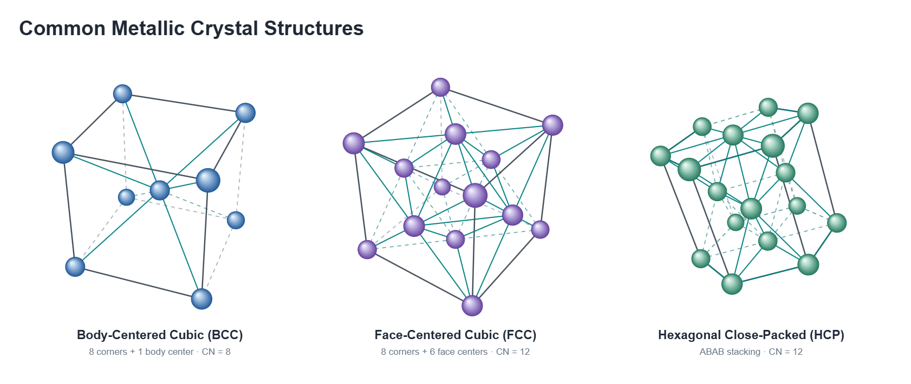

| 結構 | 原子排列 | 最近鄰配位數 |
| --- | --- | --- |
| BCC 體心立方 | 立方體角點與體心 | 8 |
| FCC 面心立方 | 立方體角點與面心 | 12 |
| HCP 六方最密堆積 | 密排層以 ABAB 方式堆疊 | 12 |

灰線：晶胞邊界；青綠線：最近鄰。配位數包含相鄰晶胞。

::: notes
來源：../reference/src/pages/crystals/crystals.html。圖中 BCC 的體心連接八個角點。畫面只顯示有限晶胞，完整配位數需包含相鄰晶胞的原子。
來源：../reference/src/pages/crystals/crystals.html。HCP 圖採理想 c/a = √(8/3)。這些是基礎結構示意，不能直接代表所有陶瓷的晶體結構。
:::

---

# 聲學與光學模態
<!-- layout: pair -->

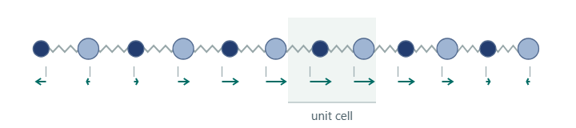

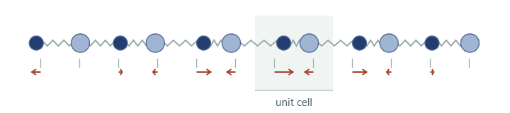

一維雙原子鏈，彈簧常數相同。A 的質量為 m，B 為 2m。

::: notes
來源：../reference/src/pages/modes/modes.html。擷取 qa/π = 0.22 的靜態畫面。靠近 Γ 時，聲學模態的兩個原子近似同向，光學模態近似反向。這些方向描述針對長波長極限，不適用於整個布里淵區。箭頭表示相對平衡位置的位移。
:::

---

# 聲子色散：頻率與波向量
<!-- layout: image -->

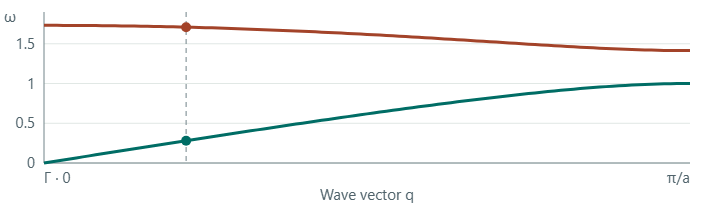

Γ 點的聲學支頻率為零；光學支維持有限頻率。

頻率單位為 √(K/m)，K 是彈簧常數。曲線為本頁雙原子鏈模型。

::: notes
來源：../reference/src/pages/modes/modes.html。在此模型，聲學支在 Γ 附近近似線性，光學支在 Γ 附近較平坦。此圖是頻率對波向量，與下一頁的位移對空間相位不同。
:::

---

# Longitudinal Acoustic and Optical Phonon Modes
<!-- layout: pair -->

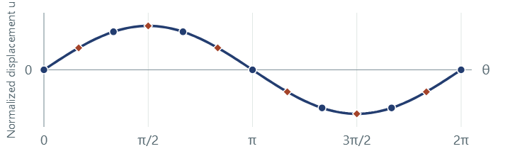

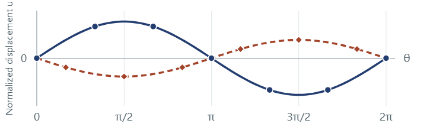

固定時間的長波長示意，縱軸為歸一化位移 u，橫軸為空間相位 θ。

Acoustic：uA = uB = sin θ

Optical：uA = sin θ，uB = −½ sin θ（假設 mB = 2mA）

::: notes
來源：../reference/src/pages/modes/modes.html。兩圖沿 k 方向觀察縱向位移。A、B 是兩個原子位置或種類的標記，不代表正負電荷。兩條反相曲線形成雙葉形狀，是位移快照，不是聲子色散支的形狀。
:::

---

# 超晶胞動力矩陣與聲子本徵模態（1/3）
<!-- layout: annotated -->

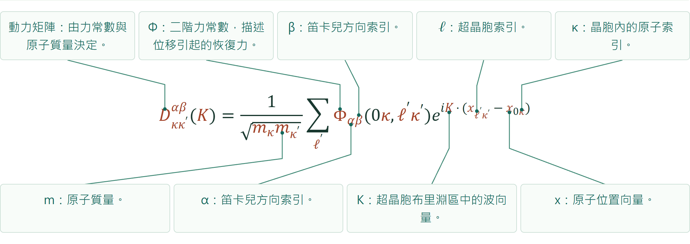

$$
D_{\kappa\kappa'}^{\alpha\beta}(\mathbf K)
=\frac{1}{\sqrt{m_\kappa m_{\kappa'}}}
\sum_{\ell'} \Phi_{\alpha\beta}(0\kappa,\ell'\kappa')
e^{i\mathbf K\cdot(\mathbf x_{\ell'\kappa'}-\mathbf x_{0\kappa})}
$$

::: notes
來源：../reference/src/pages/formulas/formulas.html。
eigenstates.py · _extract_eigenstates_for_q：../upho/phonon/eigenstates.py
Ikeda et al. Eqs. (2)、(3)、(6)：https://arxiv.org/pdf/1611.01299#page=2

Φ 是二階力常數，m 是原子質量，κ 標記胞內原子，α、β 是笛卡兒方向。對角化後，J 標記超晶胞波向量 K 上的聲子模態。ℓ 標記超晶胞，ṽ 帶有原子位置 x 的 Bloch 相位。

全參數說明圖來源：../reference/src/pages/formulas/formulas.html。
:::

---

# 超晶胞動力矩陣與聲子本徵模態（2/3）
<!-- layout: annotated -->

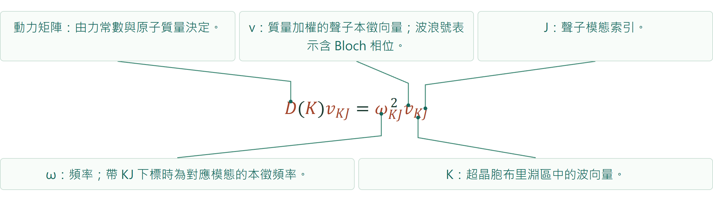

$$
D(\mathbf K)\mathbf v_{\mathbf KJ}
=\omega_{\mathbf KJ}^{\,2}\mathbf v_{\mathbf KJ}
$$

::: notes
來源：../reference/src/pages/formulas/formulas.html。
eigenstates.py · _extract_eigenstates_for_q：../upho/phonon/eigenstates.py
Ikeda et al. Eqs. (2)、(3)、(6)：https://arxiv.org/pdf/1611.01299#page=2

Φ 是二階力常數，m 是原子質量，κ 標記胞內原子，α、β 是笛卡兒方向。對角化後，J 標記超晶胞波向量 K 上的聲子模態。ℓ 標記超晶胞，ṽ 帶有原子位置 x 的 Bloch 相位。

全參數說明圖來源：../reference/src/pages/formulas/formulas.html。
:::

---

# 超晶胞動力矩陣與聲子本徵模態（3/3）
<!-- layout: annotated -->

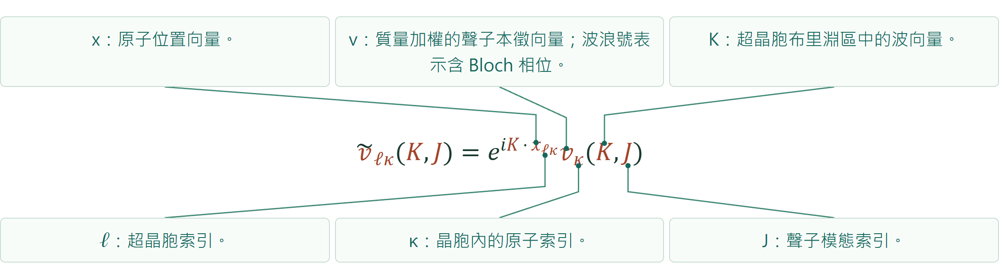

$$
\tilde{\mathbf v}_{\ell\kappa}(\mathbf K,J)
=e^{i\mathbf K\cdot\mathbf x_{\ell\kappa}}\mathbf v_{\kappa}(\mathbf K,J)
$$

::: notes
來源：../reference/src/pages/formulas/formulas.html。
eigenstates.py · _extract_eigenstates_for_q：../upho/phonon/eigenstates.py
Ikeda et al. Eqs. (2)、(3)、(6)：https://arxiv.org/pdf/1611.01299#page=2

Φ 是二階力常數，m 是原子質量，κ 標記胞內原子，α、β 是笛卡兒方向。對角化後，J 標記超晶胞波向量 K 上的聲子模態。ℓ 標記超晶胞，ṽ 帶有原子位置 x 的 Bloch 相位。

全參數說明圖來源：../reference/src/pages/formulas/formulas.html。
:::

---

# 原胞與超晶胞的波向量
<!-- layout: annotated -->

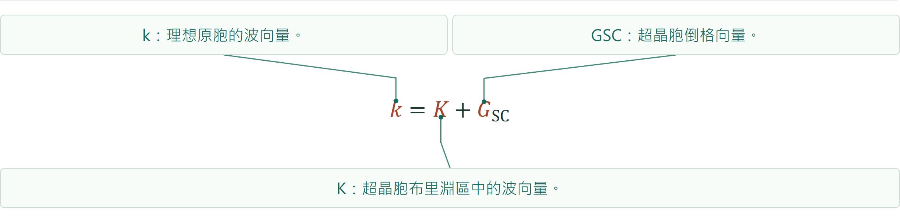

$$
\mathbf k=\mathbf K+\mathbf G_{\mathrm{SC}}
$$

::: notes
來源：../reference/src/pages/formulas/formulas.html。
eigenstates.py · get_q_sc_from_q_pc：../upho/phonon/eigenstates.py
Eq. (12)：https://arxiv.org/pdf/1611.01299#page=3

k 位於理想原胞的布里淵區，K 位於超晶胞的布里淵區，GSC 是超晶胞倒格向量。同一個 K 可對應多個原胞波向量。

全參數說明圖來源：../reference/src/pages/formulas/formulas.html。
:::

---

# 平移投影與展開權重（1/2）
<!-- layout: annotated -->

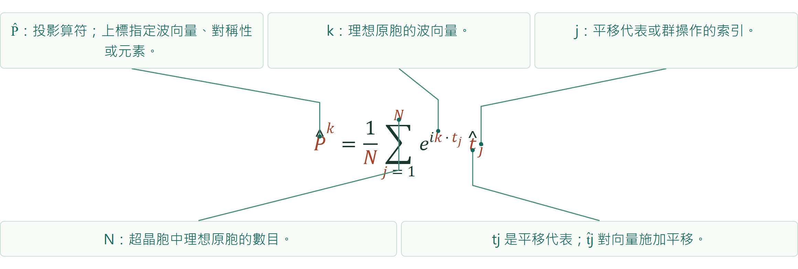

$$
\hat P^{\mathbf k}=\frac{1}{N}\sum_{j=1}^{N}
e^{i\mathbf k\cdot\mathbf t_j}\,\hat t_j
$$

::: notes
來源：../reference/src/pages/formulas/formulas.html。
translational_projector.py：../upho/phonon/translational_projector.py
eigenstates.py · _extract_weights：../upho/phonon/eigenstates.py
Eq. (17)：https://arxiv.org/pdf/1611.01299#page=4

N 是超晶胞所含的理想原胞數，tj 是平移代表。投影擷取模態在 k 上的 Bloch 分量，在一個超晶胞 ℓ 上取投影結果的平方範數，即得該模態的權重。程式把投影向量約化到一個原胞後計算範數。

全參數說明圖來源：../reference/src/pages/formulas/formulas.html。
:::

---

# 平移投影與展開權重（2/2）
<!-- layout: annotated -->

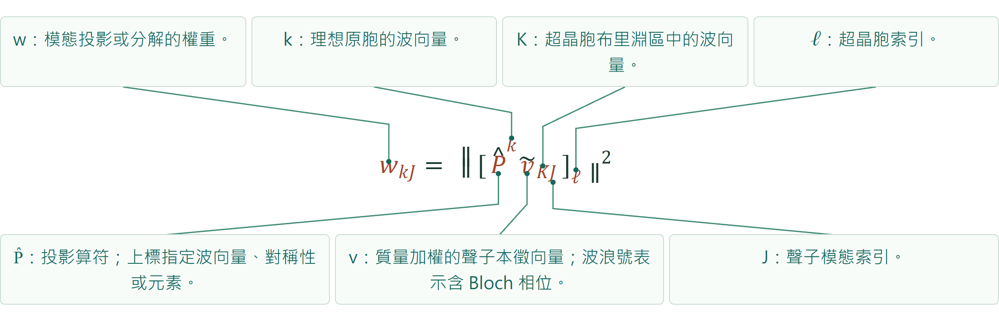

$$
w_{\mathbf kJ}=\bigl\|[\,\hat P^{\mathbf k}\tilde{\mathbf v}_{\mathbf KJ}\,]_\ell\bigr\|^2
$$

::: notes
來源：../reference/src/pages/formulas/formulas.html。
translational_projector.py：../upho/phonon/translational_projector.py
eigenstates.py · _extract_weights：../upho/phonon/eigenstates.py
Eq. (17)：https://arxiv.org/pdf/1611.01299#page=4

N 是超晶胞所含的理想原胞數，tj 是平移代表。投影擷取模態在 k 上的 Bloch 分量，在一個超晶胞 ℓ 上取投影結果的平方範數，即得該模態的權重。程式把投影向量約化到一個原胞後計算範數。

全參數說明圖來源：../reference/src/pages/formulas/formulas.html。
:::

---

# 展開聲子頻譜與 Lorentzian 展寬（1/2）
<!-- layout: annotated -->

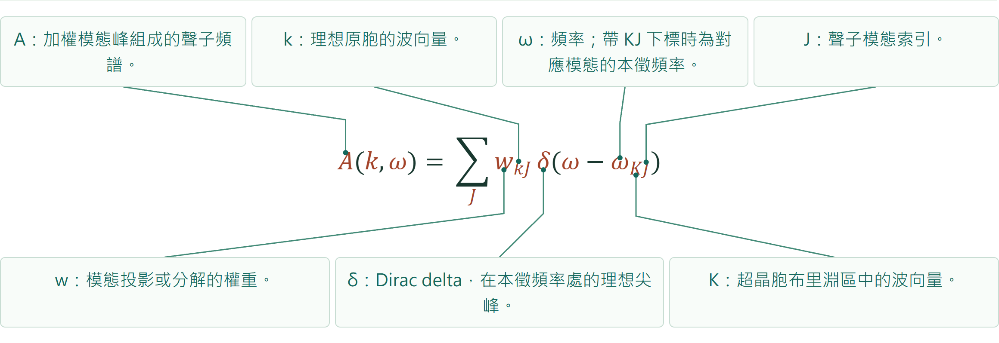

$$
A(\mathbf k,\omega)=\sum_J w_{\mathbf kJ}\,\delta(\omega-\omega_{\mathbf KJ})
$$

::: notes
來源：../reference/src/pages/formulas/formulas.html。
density_extractor.py · calculate_density：../upho/phonon/density_extractor.py
functions.py · lorentzian：../upho/analysis/functions.py
Eq. (30)：https://arxiv.org/pdf/1611.01299#page=6

每個模態在自己的頻率上提供一個由權重決定的峰。繪圖時以 Lorentzian 取代 δ 峰。η 是半高半寬（HWHM），兩個範例使用 0.05 THz。

全參數說明圖來源：../reference/src/pages/formulas/formulas.html。
:::

---

# 展開聲子頻譜與 Lorentzian 展寬（2/2）
<!-- layout: annotated -->

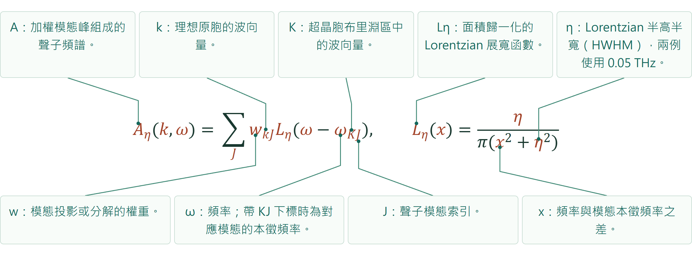

$$
A_{\eta}(\mathbf k,\omega)=\sum_J w_{\mathbf kJ}L_\eta(\omega-\omega_{\mathbf KJ}),
\qquad
L_\eta(x)=\frac{\eta}{\pi(x^2+\eta^2)}
$$

::: notes
來源：../reference/src/pages/formulas/formulas.html。
density_extractor.py · calculate_density：../upho/phonon/density_extractor.py
functions.py · lorentzian：../upho/analysis/functions.py
Eq. (30)：https://arxiv.org/pdf/1611.01299#page=6

每個模態在自己的頻率上提供一個由權重決定的峰。繪圖時以 Lorentzian 取代 δ 峰。η 是半高半寬（HWHM），兩個範例使用 0.05 THz。

全參數說明圖來源：../reference/src/pages/formulas/formulas.html。
:::

---

# SR · 小群不可約表示（1/2）
<!-- layout: annotated -->

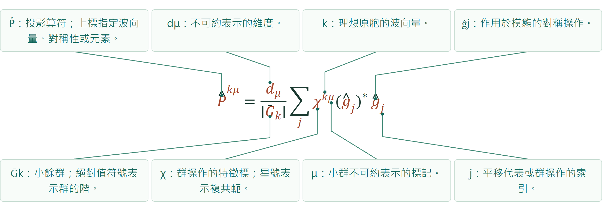

$$
\hat P^{\mathbf k\mu}=\frac{d_\mu}{|\bar G_{\mathbf k}|}
\sum_j \chi^{\mathbf k\mu}(\hat g_j)^*\,\hat g_j
$$

::: notes
來源：../reference/src/pages/formulas/formulas.html。
rotational_projector.py：../upho/phonon/rotational_projector.py
Eqs. (24)、(32)：https://arxiv.org/pdf/1611.01299#page=5

μ 標記 k 的小群不可約表示，dμ 是其維度，χ 是特徵標，|Ḡk| 是小餘群的階。把總譜的權重換成這組對稱性權重，即得到 sf_SR.dat 的各分量。

全參數說明圖來源：../reference/src/pages/formulas/formulas.html。
:::

---

# SR · 小群不可約表示（2/2）
<!-- layout: annotated -->

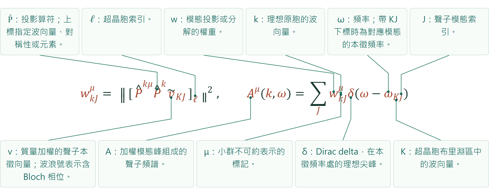

$$
w_{\mathbf kJ}^{\mu}
=\bigl\|[\,\hat P^{\mathbf k\mu}\hat P^{\mathbf k}
\tilde{\mathbf v}_{\mathbf KJ}\,]_\ell\bigr\|^2,\qquad
A^\mu(\mathbf k,\omega)=\sum_J w_{\mathbf kJ}^{\mu}\delta(\omega-\omega_{\mathbf KJ})
$$

::: notes
來源：../reference/src/pages/formulas/formulas.html。
rotational_projector.py：../upho/phonon/rotational_projector.py
Eqs. (24)、(32)：https://arxiv.org/pdf/1611.01299#page=5

μ 標記 k 的小群不可約表示，dμ 是其維度，χ 是特徵標，|Ḡk| 是小餘群的階。把總譜的權重換成這組對稱性權重，即得到 sf_SR.dat 的各分量。

全參數說明圖來源：../reference/src/pages/formulas/formulas.html。
:::

---

# E1 · 元素對投影
<!-- layout: annotated -->

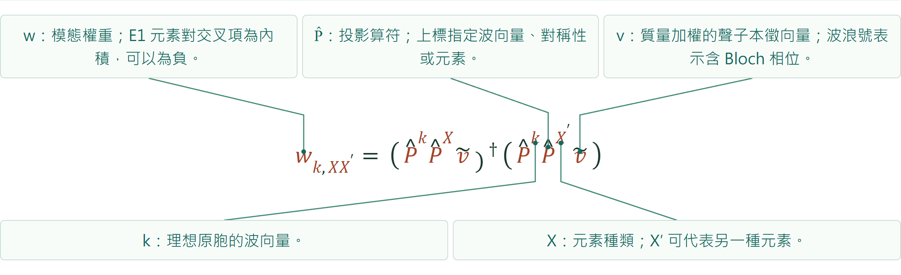

$$
w_{\mathbf k,XX'}=
\bigl(\hat P^{\mathbf k}\hat P^X\tilde{\mathbf v}\bigr)^\dagger
\bigl(\hat P^{\mathbf k}\hat P^{X'}\tilde{\mathbf v}\bigr)
$$

::: notes
來源：../reference/src/pages/formulas/formulas.html。
projection.rst · E1：../docsrc/projection.rst
eigenstates.py · _create_weights_e1：../upho/phonon/eigenstates.py

P̂X 選取屬於元素 X 的向量分量。E1 先按元素分解，再做平移投影，最後取內積。sf_E1.dat 的不同元素交叉項可以為負。

全參數說明圖來源：../reference/src/pages/formulas/formulas.html。
:::

---

# E2 · 個別元素權重
<!-- layout: annotated -->

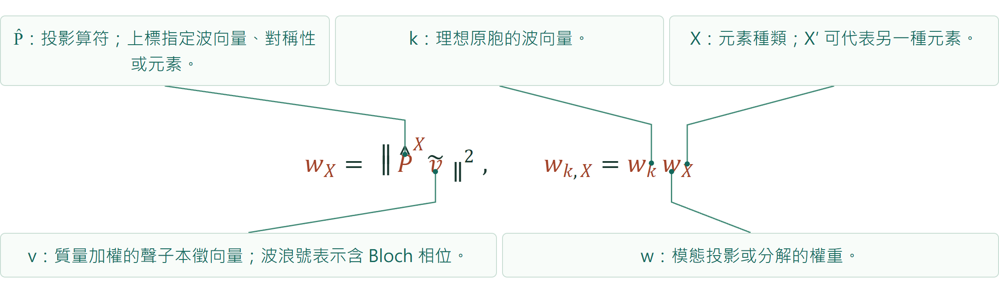

$$
w_X=\bigl\|\hat P^X\tilde{\mathbf v}\bigr\|^2,\qquad
w_{\mathbf k,X}=w_{\mathbf k}\,w_X
$$

::: notes
來源：../reference/src/pages/formulas/formulas.html。
projection.rst · E2：../docsrc/projection.rst
eigenstates.py · _create_weights_e2：../upho/phonon/eigenstates.py

以各元素的模態權重乘上總展開權重，得到 sf_E2.dat 的元素分量。此分解不含 E1 的元素對交叉項。

全參數說明圖來源：../reference/src/pages/formulas/formulas.html。
:::

---

# 對稱等價波向量平均
<!-- layout: annotated -->

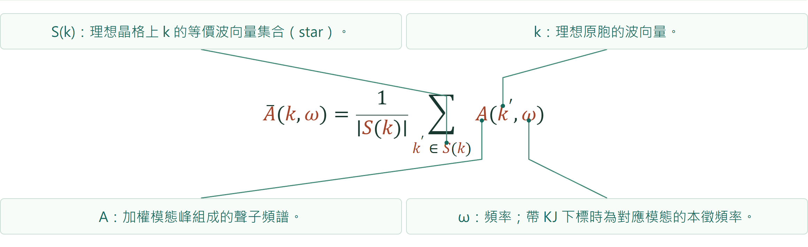

$$
\overline A(\mathbf k,\omega)=\frac{1}{|\mathcal S(\mathbf k)|}
\sum_{\mathbf k'\in\mathcal S(\mathbf k)} A(\mathbf k',\omega)
$$

::: notes
來源：../reference/src/pages/formulas/formulas.html。
eigenstates.py · extract_eigenstates：../upho/phonon/eigenstates.py
Eq. (36)：https://arxiv.org/pdf/1611.01299#page=7

啟用波向量的 star 平均時，對理想晶格上選定的等價波向量求平均。程式先按 star 大小縮放權重，產生頻譜時再把各波向量分量加總。

全參數說明圖來源：../reference/src/pages/formulas/formulas.html。
:::

---

# Cu–Au 算例的展開對象
<!-- layout: table -->

| 算例 | 展開與比較內容 | 理想參考晶格 |
| --- | --- | --- |
| L1₂ Cu₃Au | 有序結構，沿指定高對稱路徑比較權重 | FCC 母晶格 |
| A1 Cu₀.₇₅Au₀.₂₅ | 108 原子無序超晶胞，比較總譜與分解分量 | FCC 原胞 |

總譜、對稱分量與元素分量提供不同角度，分析化學無序下的分支特徵。

::: notes
來源：../reference/src/pages/formulas/formulas.html；../examples/00.L12_Cu3Au/README.md；../examples/01.A1_Cu0.75Au0.25/README.md。
參考：Ikeda et al., Phys. Rev. B 95, 024305 (2017)，https://doi.org/10.1103/PhysRevB.95.024305。
:::

---

# 從投影權重到聲子圖譜
<!-- layout: text -->

1. 計算展開權重
upho_weights band.conf

2. 以 Lorentzian 展寬產生文字頻譜
upho_sf --fpitch 0.01 -s 0.05 --function lorentzian --format text

3. 繪製總譜、強度增強圖與局部峰值圖
upho_plot

::: notes
來源：../reference/src/pages/formulas/formulas.html、../scripts/upho_plot、../docsrc/output.rst。
在各例子資料夾執行。fpitch = 0.01 THz 是頻率網格間距，s = 0.05 THz 是 Lorentzian 半高半寬。SR 是對稱性分解，E1 是元素對分解，E2 是個別元素權重分解。後續八頁展示兩個例子的既有圖檔。
:::

---

# 例一 L1₂ Cu₃Au：原始參考圖
<!-- layout: spectrum -->

Cu 75 at.%、Au 25 at.%；保留 repo 內原始參考圖的標示。

::: notes
來源：../examples/00.L12_Cu3Au/sf.orig.svg。此圖與後續重新繪製的圖可能具有不同的座標標示或色階。跨圖比較需注意其原始設定。
:::

---

# 例一 L1₂ Cu₃Au：線性強度圖
<!-- layout: spectrum -->

Cu 75 at.%、Au 25 at.%；顏色表示聲子譜強度。

::: notes
來源：../examples/00.L12_Cu3Au/sf.svg；繪圖腳本：../scripts/upho_plot。
:::

---

# 例一 L1₂ Cu₃Au：Gamma 強度增強
<!-- layout: spectrum -->

γ = 0.35，增強較暗分支的可見度，原始譜資料不變。

::: notes
來源：../examples/00.L12_Cu3Au/sf_gamma.svg；../scripts/upho_plot。Gamma correction 是顏色映射的非線性轉換，不會增加聲子譜的原始強度。
:::

---

# 例一 L1₂ Cu₃Au：局部峰值
<!-- layout: spectrum -->

從 sf_SR.dat 提取沿頻率方向的局部峰值，標示候選分支位置。

::: notes
來源：../examples/00.L12_Cu3Au/sf_ridges.svg；../scripts/upho_plot。合併總譜與對稱性通道的局部峰值。結果依賴峰值門檻，不能保證找出所有分支，也不等同於跨波向量追蹤模態。
:::

---

# 例二 A1 Cu₀.₇₅Au₀.₂₅：原始參考圖
<!-- layout: spectrum -->

Cu 75 at.%、Au 25 at.%；無序合金例子。

::: notes
來源：../examples/01.A1_Cu0.75Au0.25/sf.orig.svg。保留原圖標示，與後續輸出比較需留意座標與色階差異。
:::

---

# 例二 A1 Cu₀.₇₅Au₀.₂₅：線性強度圖
<!-- layout: spectrum -->

展開後的聲子譜呈現於參考晶體的波向量路徑。

::: notes
來源：../examples/01.A1_Cu0.75Au0.25/sf.svg；../examples/01.A1_Cu0.75Au0.25/README.md。此頁呈現 repo 的合金算例，不將它解讀成陶瓷配方篩選成果。
:::

---

# 例二 A1 Cu₀.₇₅Au₀.₂₅：Gamma 強度增強
<!-- layout: spectrum -->

γ = 0.35，讓低強度分支更容易辨識。

::: notes
來源：../examples/01.A1_Cu0.75Au0.25/sf_gamma.svg；../scripts/upho_plot。顏色映射經過轉換，定量強度仍以原始資料及色條為準。
:::

---

# 例二 A1 Cu₀.₇₅Au₀.₂₅：局部峰值
<!-- layout: spectrum -->

局部峰值提供候選分支位置；分支的完整性仍需檢查。

::: notes
來源：../examples/01.A1_Cu0.75Au0.25/sf_ridges.svg；../scripts/upho_plot。展寬、重疊與弱峰可能影響提取結果。後續若作為學習目標，需另外定義特徵、物理約束與驗證方法。
:::
